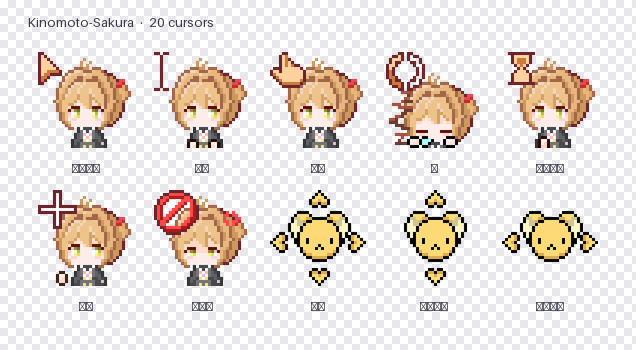

# cursor-manager

**Linux 鼠标光标主题管理器 —— 浏览、动画预览、一键切换、导入 Windows 光标包。**

[](https://github.com/liusuan233/cursor-manager/releases)
[](LICENSE)
[](https://www.python.org/)
[](https://gtk.org/)
[](#环境要求)


<sub>上图由 `docs/make_preview.py` 从光标主题直接解码生成，可复现。</sub>

---

## 为什么做这个

在 niri / Wayland 上换鼠标光标主题，是那种"明明做了配置却毫无反应"的经典坑。
现有工具（nwg-look、lxappearance）都不认 niri 和 DMS，换完经常只有一半程序变了样。

根子在于 **Wayland 下没有全局光标设置**。每个程序各查各的：

| 谁 | 从哪读 |
|---|---|
| niri 自己画的光标 | `config.kdl` 的 `cursor { xcursor-theme }` |
| niri 启动的子进程 | `environment { XCURSOR_THEME }` |
| DMS 桌面外壳 | `~/.config/niri/dms/cursor.kdl`（DMS 自动生成） |
| GTK3 / GTK4 应用 | `settings.ini` 的 `gtk-cursor-theme-name` |
| XWayland 应用 | `~/.Xresources` 的 `Xcursor.theme` |
| 走 GSettings 的程序 | `org.gnome.desktop.interface cursor-theme` |

而**所有**这些实现都遵守同一条硬规则：

```
<主题目录>/cursors/<光标名>
```

`cursors/` 这一层不能省。`libXcursor` 兼容平铺老布局（所以 niri 自己的光标可能看着是对的），
但 `libwayland-cursor`（GTK4 / Firefox / Electron 都走它）**只认 `cursors/`**。
少一层 → 静默回落到 Adwaita → **不报任何错**。

这个工具把上面每一环都变成界面上看得见的状态，并一次性写全。

---

## 功能

- **主题一览** —— 扫描 `~/.local/share/icons`、`~/.icons`、`/usr/share/icons`，
  自动校验 `cursors/` 布局，把"装了也不会生效"的主题直接标红
- **动画预览** —— 解码 Xcursor 二进制格式，逐帧播放。这种格式普通图片查看器打不开
- **按实际尺寸预览** —— 96px 放大看细节，或按要应用的尺寸 1:1
- **别名提示** —— 悬停显示该光标的所有别名和尺寸档位映射
- **一键应用** —— 同时写全 6 个配置点，逐项报告结果，可选干跑
- **导入 Windows 光标包** —— `.ani`/`.cur`/`.ico`、`.zip`/`.tar.gz`/文件夹都能吃，
  优先读包内 `.inf` 拿到微软官方的角色映射
- **命令行** —— `--list` / `--import` / `apply`，不需要 GTK 也能在服务器上跑

---

## 安装

### 从 Release 下载（推荐）

打开 [Releases](https://github.com/liusuan233/cursor-manager/releases) 页面，按下表选一个文件下载：

| 你的系统 | 下载 | 安装 |
|---|---|---|
| **Arch Linux** | `cursor-manager-<版本>-1-any.pkg.tar.zst` | `sudo pacman -U <文件>` |
| **其他发行版** | `cursor-manager-<版本>.tar.gz` | 解包即用，或跑里面的 `./install.sh` |
| **pipx 用户** | `cursor_manager-<版本>-py3-none-any.whl` | `pipx install <文件>` |

<sub>文件名里的 `<版本>` 随 release 变化，比如 `1.0.0`。</sub>

**Arch Linux**

```bash
sudo pacman -U cursor-manager-1.0.0-1-any.pkg.tar.zst
```

依赖（`python-gobject`、`gtk4`、`python-numpy`、`python-pillow`）会由 pacman 自动装。
装完 `cursor-manager` 就在 `/usr/bin` 里，桌面入口和图标一并注册，
卸载走 `pacman -R cursor-manager`。

**其他发行版（源码包，解包即用）**

```bash
tar -xzf cursor-manager-1.0.0.tar.gz
cd cursor-manager-1.0.0

./cursor-manager           # 方式一：直接运行，不动系统
./install.sh               # 方式二：装到 ~/.local（含桌面入口和图标）
./install.sh --uninstall   # 卸载
```

解包后不需要编译，也不需要 `make`。

**pipx**

```bash
pipx install cursor_manager-1.0.0-py3-none-any.whl
```

> **PyGObject 装不上？** 它无法用 pip 可靠安装（需要系统库 + 编译），必须走发行版包管理器。
> 而且它只影响图形界面 —— `--list` / `--import` / `apply` 这些命令行功能不需要它。
>
> ```bash
> sudo pacman -S python-gobject gtk4                    # Arch
> sudo apt install python3-gi gir1.2-gtk-4.0            # Debian / Ubuntu
> sudo dnf install python3-gobject gtk4                 # Fedora
> ```

**校验下载的文件**（Release 里附有 `SHA256SUMS`）

```bash
sha256sum -c SHA256SUMS
```

---

### 从源码安装（想改代码 / 用最新提交）

```bash
git clone https://github.com/liusuan233/cursor-manager
cd cursor-manager

./cursor-manager      # 直接跑
./install.sh          # 或装到 ~/.local
pipx install .        # 或用 pipx

# Arch 用户也可以自己打本地包
make pkg              # 需要 python-pip / python-setuptools / python-wheel
sudo pacman -U packaging/cursor-manager-*.pkg.tar.zst
```

只想用的话，上面的 Release 方式更省事。

---

## 用法

### 图形界面

```bash
cursor-manager
```

| 操作 | 作用 |
|---|---|
| 点左侧主题 | 右侧出预览网格；启动时自动选中当前生效的那个 |
| 尺寸下拉 | 同时决定"要应用的尺寸"和预览大小 |
| 放大预览 / 实际大小 | 96px 放大看细节 ↔ 按要应用的尺寸 1:1 |
| 动画开关 | 关掉可省 CPU（20 个光标同时动画） |
| 悬停格子 | 显示该光标的档位映射和全部别名 |
| 应用到系统 | 一次写全 6 个配置点，弹窗逐项报告结果 |
| 导入主题 ▾ | 从压缩包/光标文件，或从文件夹导入 Windows 光标包 |

### 命令行

```bash
cursor-manager                              # 打开图形界面
cursor-manager --list [-v]                  # 列出已安装主题（-v 显示路径和尺寸范围）
cursor-manager apply <主题名> [尺寸]         # 切换主题
cursor-manager apply <主题名> 24 --dry-run  # 只报告会改哪些文件
cursor-manager --import <路径> [选项]        # 导入光标包
cursor-manager --help
```

`apply` 会依次写入 niri、DMS、GTK3、GTK4、`.Xresources`、gsettings 六处。
niri 保存配置后会自动重载，但**已经开着的程序需要重启**。

---

## 导入 Windows 光标包

支持 **文件夹 / `.zip` / `.tar.gz` / `.tar.xz` / `.tar.bz2` / 单个 `.ani`/`.cur`/`.ico`**。

```bash
cursor-manager --import ~/下载/Sakura.zip
```

```
✔ 导入完成   KINOMOTO-SAKURA
  原名      : KINOMOTO SAKURA（主题名已清洗成 ASCII 安全）
  角色映射  : 包内 .inf（官方数据）
  识别角色  : 17 个 / 146 帧 / 17 个动画
  原始分辨率: 256×256
  转出      : 17 个光标文件 + 113 个别名（46.1 MB）
  安装位置  : ~/.local/share/icons/KINOMOTO-SAKURA
```

### 它怎么做的

**角色映射优先读包内的 `.inf`。** 微软光标包都带一个 `.inf`，`[Strings]` 段
**直接写着官方映射**：

```ini
[Strings]
SCHEME_NAME = "KINOMOTO SAKURA"
pointer     = "pointer.ani"
work        = "working.ani"      ; ← AppStarting
hand        = "handwriting.ani"  ; ← NWPen（手写笔）
link        = "link.ani"         ; ← 链接选择手
```

这是权威数据，比按文件名猜可靠得多。没有 `.inf` 时才退回关键词匹配，
并且会明确告诉你"这是推断的、缺了哪几个角色"。

**17 个 Windows 角色 → Xcursor 名**

| 角色 | 含义 | Xcursor 名 | | 角色 | 含义 | Xcursor 名 |
|---|---|---|---|---|---|---|
| pointer | 正常选择 | `left_ptr` | | dgn2 | 对角线／ | `bottom_left_corner` |
| help | 帮助选择 | `question_arrow` | | move | 移动 | `move` |
| work | 后台运行 | `left_ptr_watch` | | alternate | 候选选择 | `center_ptr` |
| busy | 忙 | `wait` | | link | 链接选择 | `hand2` |
| cross | 精确选择 | `cross` | | loc | 位置选择 | `cell` |
| text | 文本选择 | `xterm` | | person | 人员 | `person` |
| hand | 手写 | `pencil` | | vert | 垂直调整 | `bottom_side` |
| unavailable | 不可用 | `circle` | | horz | 水平调整 | `left_side` |
| dgn1 | 对角线＼ | `bottom_right_corner` | | | | |

再加上约 110 个**别名**（`default`、`pointer`、`progress`、`ew-resize`、`not-allowed`、
`col-resize`… 以及 `00000000000000020006000e7e9ffc3f` 这类旧版 Firefox/Chromium
用的名字 MD5）。别名漏了哪个，哪个名字的请求就会回落到 `Inherits` 主题 ——
于是出现"一半 Sakura 一半白箭头"。

**尺寸。** Windows 光标包通常是 256×256，而 Linux 上 24–96 才是常用范围，
所以会从原始分辨率**降采样**出多个档位（降采样几乎无损，升采样才会糊）。
默认 `24,32,48,64,96`，并且总是保留原始分辨率那一档。

**主题名会清洗成 ASCII 安全。** `KINOMOTO SAKURA` → `KINOMOTO-SAKURA`，
U+2011 断字连字符、CJK、空格、括号全部折成 `-`。这不是洁癖：主题名要写进
niri 的 KDL、GTK 的 ini 和 `XCURSOR_THEME` 环境变量，任何"看起来一样但码点不同"
的字符都是灾难点 —— 这个项目的起因就是 U+2011。

---

## 项目结构

```
cursorkit/                    核心库 + 界面（也可单独作为库使用）
├── xcursor.py                Xcursor 二进制格式 读 / 写
├── windows.py                Windows .ani / .cur / .ico 解析
├── importer.py               角色映射 + 主题包导入
├── themes.py                 主题扫描、布局校验、别名归并
├── apply.py                  写入 6 个配置点 + 读回状态
├── cli.py                    命令行子命令（不导入 GTK）
├── gui.py                    GTK4 界面
└── __main__.py               统一入口：有子命令走 cli，否则开窗

cursor-manager                直接从源码目录运行的入口
selftest_gui.py               GUI 自检（29 项）
selftest_import.py            导入器自检（38 项）
docs/make_preview.py          生成 README 预览图
docs/NOTES.md                 格式笔记与踩坑记录
packaging/PKGBUILD            Arch 包
```

### 作为库使用

```python
from cursorkit import scan_themes, apply_theme, CursorFile
from cursorkit.importer import import_pack

for t in scan_themes():
    print(t.name, "✔" if t.valid else f"✘ {t.reason}")

cur = scan_themes()[0].find("left_ptr")
cf  = CursorFile.load(cur.path, want=96)      # 只解码最接近 96 的那一档
print(cf.sizes, cf.frame_count, cf.animated)

res = import_pack("~/下载/Sakura.zip", sizes=(24, 32, 48))
print(res.dest, res.files_written, res.aliases_created)

apply_theme("KINOMOTO-SAKURA", 24)             # 写全 6 处
apply_theme("Adwaita", 24, dry_run=True)       # 只报告不写盘
```

---

## 开发

```bash
make test        # 两个自检：GUI 29 项 + 导入器 38 项
make check       # 只跑不需要显示服务器的那个
make dist        # 源码 tarball
make wheel       # Python wheel
make pkg         # Arch 包
make verify      # 把 wheel 装进干净 venv 跑一遍，验证导出可用
```

两个自检都**不需要人看图**，退出码非 0 即失败：

- `selftest_import.py` —— 会自己合成光标包，没有真实素材也能完整跑；
  设 `CURSORKIT_TEST_PACK=<目录>` 可额外验证真实包
- `selftest_gui.py` —— 构造真实窗口、跑事件循环、检查控件树实际状态

另有 `verify_cursor.c`：用 libXcursor 官方 API 验证"主题名能否真的被加载"。

```bash
gcc -O2 -o verify_cursor verify_cursor.c $(pkg-config --cflags --libs xcursor)
./verify_cursor Kinomoto-Sakura
XCURSOR_PATH=/path/to/icons ./verify_cursor MyTheme
```

技术细节（Xcursor / ANI 格式、以及开发中踩过的 6 个真 bug）见
[`docs/NOTES.md`](docs/NOTES.md)。

---

## 环境要求

- Linux + Wayland（niri、DMS 为最佳适配；GNOME/KDE 也能用 `apply` 的部分功能）
- Python 3.10+
- PyGObject + GTK4（仅 GUI 需要，CLI 不需要）
- numpy（可选，装了快很多；没装自动退回纯 Python 解码）
- Pillow（可选但强烈建议：解码非 32bpp 光标、高质量缩放）

```bash
sudo pacman -S python-gobject gtk4 python-numpy python-pillow
```

---

## 许可

[MIT](LICENSE)
